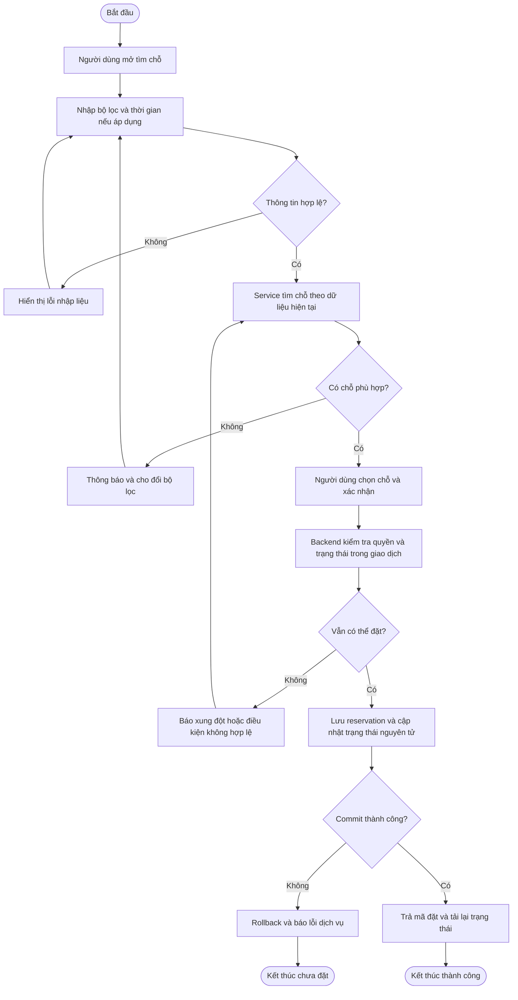
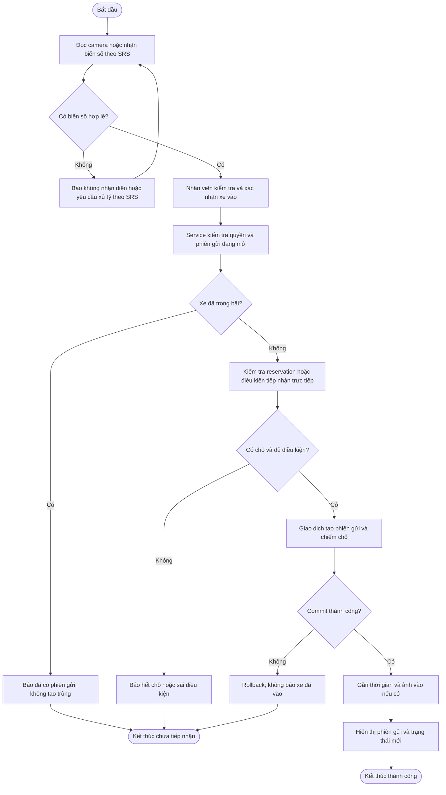
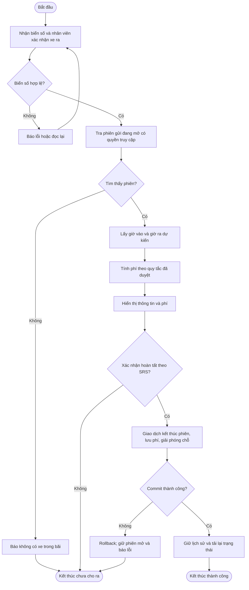

# Bản nháp ba Activity Diagram

Nguồn Activity UML có swimlane để nhóm mở bằng PlantUML:
[đặt chỗ](reservation.puml), [xe vào](entry.puml), [xe ra](exit.puml).
Các flowchart dưới đây giúp xem nhanh luồng trên GitHub.

Các sơ đồ Mermaid dưới đây là bản mô tả luồng để nhóm duyệt. Muốn nộp Activity UML
chuẩn, chuyển thành UML với nút đầu/cuối, action, decision/merge, guard và swimlane.
Phân lane tối thiểu: Người dùng/Nhân viên — Giao diện — Service — CSDL.
Tác nhân và quyền chính thức phải theo ma trận TV1; quy tắc trạng thái theo WBS 2.5.

## A. Đặt chỗ

Giả định cần duyệt: người dùng đã đăng nhập; đặt theo khoảng thời gian chỉ khi SRS
yêu cầu. Backend TV2 chịu trách nhiệm chống xung đột bằng giao dịch/ràng buộc dữ liệu.

Nhánh hủy bổ sung cho WBS 3.6: chọn đặt của mình → xác nhận hủy → backend kiểm tra
quyền/trạng thái/thời hạn → cập nhật trạng thái → phản hồi → tải lại danh sách.
Không giải phóng chỗ đang có xe chỉ vì người dùng nhấn hủy.

## B. Xe vào

Giả định cần duyệt: nhân viên vận hành xác nhận biển số; trường hợp không có reservation
có được tiếp nhận hay không phải theo quy tắc nhóm, không suy ra từ repo OCR.

Đối với demo tham khảo chưa có CSDL/chỗ: rút gọn bước giao dịch thành kiểm tra thư mục
và lưu ảnh theo TV3, ghi rõ đây chỉ là mô phỏng. Cần chốt ảnh là bắt buộc hay tùy chọn;
nếu bắt buộc thì lỗi lưu ảnh phải được xử lý nhất quán với phiên gửi.

## C. Xe ra

Giả định cần duyệt: phí do TV3 cung cấp theo bảng quy tắc, thanh toán ở mức giả lập.
Nếu SRS không yêu cầu thanh toán thì bỏ action xác nhận thanh toán, không tự thêm hệ thống tiền thật.

Khác biệt cần nêu trong báo cáo: repo OCR tham khảo xóa thư mục ảnh khi xe ra, không có
giao dịch và lịch sử trong CSDL. Không vẽ các thành phần WBS rồi nói chúng đã được
hiện thực trong repo mẫu nếu chưa có code và kiểm thử tương ứng.
