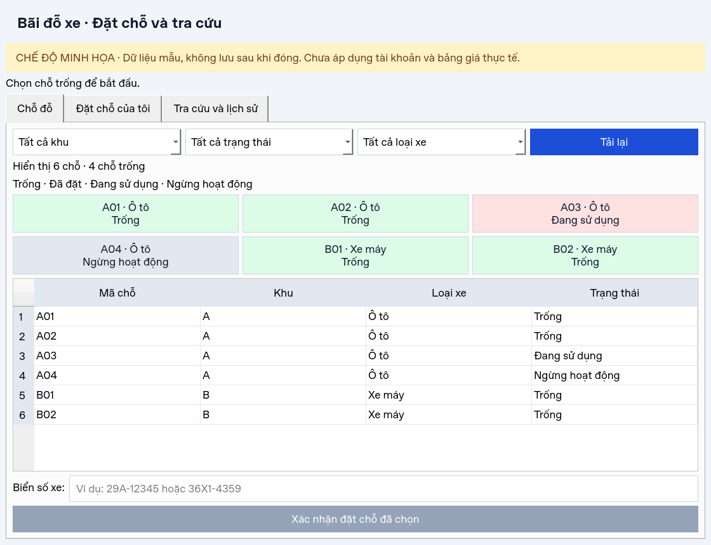
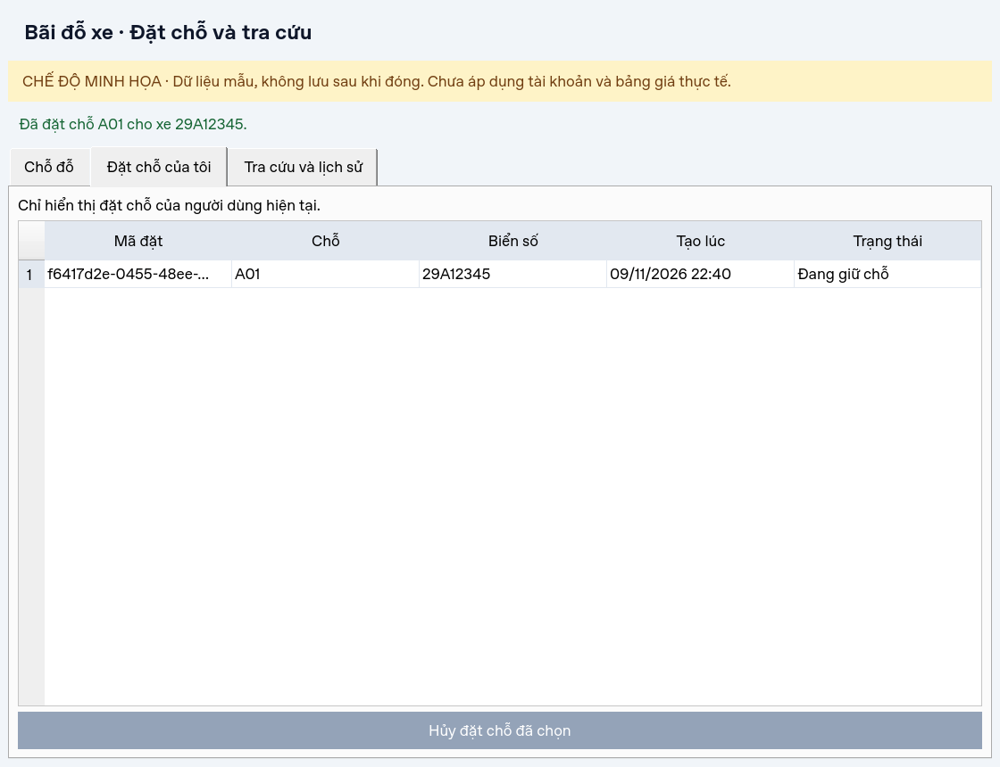
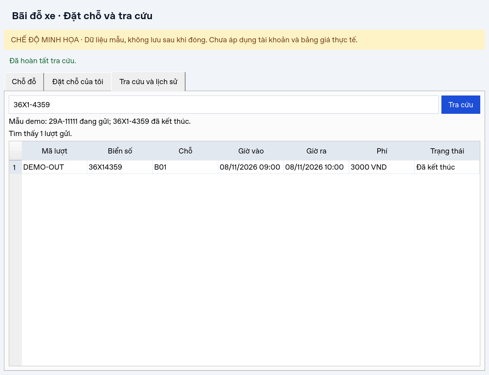
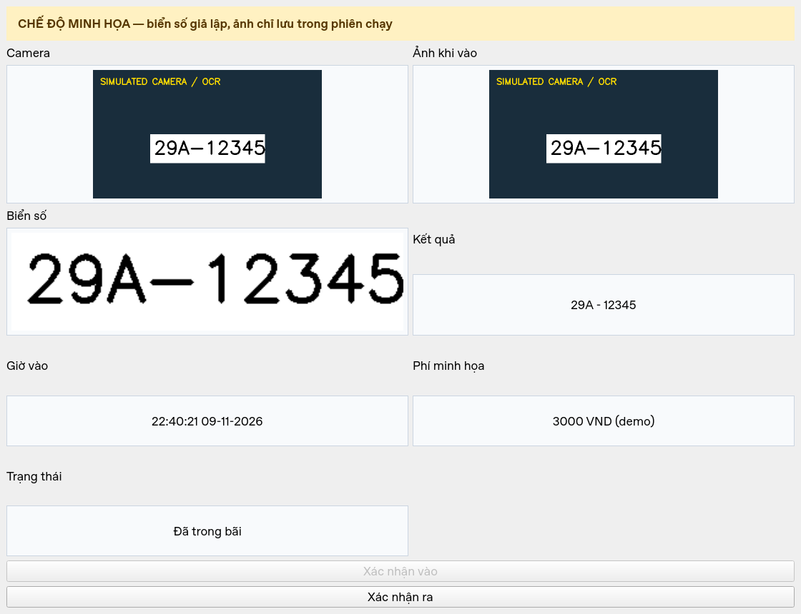

# Báo cáo kiểm thử TV4 — 09/11/2026

## Môi trường đã chạy

- Linux, Python 3.12.14.
- Môi trường riêng cài từ `requirements-tv4.txt`.
- NumPy 2.2.6, OpenCV Python 4.12.0.88, PyQt5 5.15.11, pytest 8.4.2.
- Qt dùng `QT_QPA_PLATFORM=offscreen` trong môi trường không có màn hình.
- `pip check`: không có dependency bị hỏng.

## Lệnh và kết quả

```bash
QT_QPA_PLATFORM=offscreen python -m pytest -q --junitxml=docs/tv4/evidence/pytest.xml
QT_QPA_PLATFORM=offscreen python scripts/tv4_capture_demo.py --video
python -m pip check
```

Kết quả tự động: **60 ca đạt, 0 lỗi**. Kết quả từng ca nằm trong
[JUnit XML](evidence/pytest.xml). Script demo xác nhận lọc chỗ, đặt, hủy, tra cứu
lịch sử, validation, camera vào/ra và đóng nguồn thành công.

## Phạm vi được kiểm tra

| Nhóm | Các hành vi có bằng chứng tự động |
|---|---|
| Chuyển ảnh | BGR→RGB đúng màu, dữ liệu QImage độc lập, NumPy slice, ảnh sai kiểu/rỗng |
| Controller | Vào/ra, chống lưu lặp, mất nhận diện xóa trạng thái cũ, EOF, box sai/nhiều box |
| Lỗi và tài nguyên | OCR lỗi, lưu lỗi, ảnh đã lưu hỏng, camera không mở, model thiếu, closeEvent Qt thật |
| Khởi chạy | Import không mở UI; demo chạy khi UI/OCR của nhóm chưa đầy đủ |
| Đặt chỗ demo | Giữ/hủy, không đặt chỗ đóng/đang dùng, hai yêu cầu cạnh tranh chỉ một thành công |
| Quyền/trạng thái demo | Không hủy đặt của danh tính khác, không hủy để giải phóng chỗ đang có xe |
| Tra cứu | Chuẩn hóa, chuỗi lỗi, đang gửi/đã ra/không có dữ liệu, giới hạn danh tính demo |
| UI Qt | Lọc, sơ đồ chọn chỗ, nút đặt/hủy, từ chối xác nhận, xung đột, lỗi dịch vụ, xóa kết quả cũ |
| Phí demo | Giá cố định minh họa; từ chối thời gian đảo ngược và thiếu timezone |

Camera và OCR trong test là mô phỏng. Qt và OpenCV là thư viện thật. DemoGateway
là adapter trong bộ nhớ, không phải backend/CSDL đã tích hợp. Kiểm tra quyền demo
không thay thế kiểm thử đăng nhập và phân quyền của hệ thống nhóm.

## Bằng chứng giao diện









[Video chạy thử theo kịch bản](evidence/tv4-demo.webm).
Video là bản chạy tự động các thao tác demo, không đo hiệu năng/FPS thực tế.

## Những gì chưa được kết luận

- Độ chính xác và hiệu năng hai model YOLO thật.
- Camera vật lý và pipeline UI/OCR của TV1/TV2 khi hoàn thiện.
- Reservation/tra cứu với CSDL thật, xác thực và nhiều tiến trình/client.
- Chính sách phí ngày/đêm, làm tròn, qua ngày, thanh toán chính thức.
- Hành vi trên máy Windows/máy thuyết trình của nhóm.

34 ca trong [CSV tích hợp](manual-test-cases.csv) vẫn để `Chưa chạy` hoặc `Chờ quy tắc`
vì đó là ca dành cho hệ thống tích hợp thật. Không đánh đồng 60 test demo với 34 ca này.
